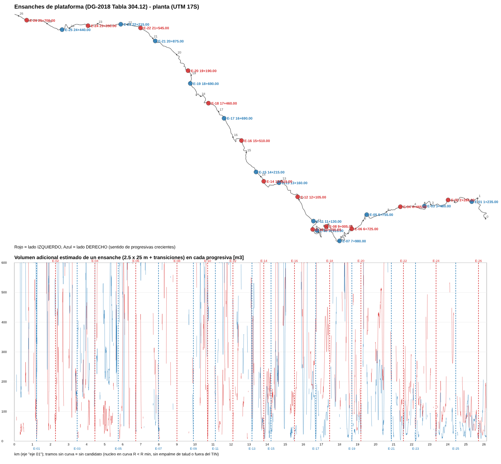

# Ensanches de plataforma (DG-2018 §304.12.03, Tabla 304.12)

Herramienta que, a partir de un **LandXML exportado de Civil 3D** (eje, rasante, bordes de calzada y
superficie de terreno), ubica los **ensanches de plataforma** exigidos cuando las bermas son menores a
2.60 m (aquí la vía **no tiene bermas**), a ambos lados de la vía y **en forma alternada**, eligiendo las
progresivas donde el **movimiento de tierras adicional es mínimo**, y los dibuja en archivos importables
en Civil 3D / AutoCAD.

## Datos del proyecto analizado

| Dato | Valor |
|---|---|
| Archivo | `DISEÑO EJE UNIDO - CARRETERA-EJE FINAL 2.0.xml` (Civil 3D 2027, UTM WGS84 17S, EPSG 32717) |
| Eje / rasante | `eje 01` (L = 26,154.04 m) / `Rs-eje 01` (213 PVI, cota 1438.65 → 338.34) |
| Bordes de calzada | `carril` (izquierdo, 3.30 m + sobreanchos) y `carril (6)` (derecho) → calzada 6.60 m |
| Superficie | `TN` (TIN, 66,719 triángulos; incluye la plataforma existente) |
| Clasificación asumida | Carretera de **Segunda Clase**, orografía **Escarpada**, V = 40 km/h (propiedad `speed` del eje) |
| Bermas | **0.00 m** (no se consideran bermas; por eso aplican los ensanches) |

## Criterio normativo aplicado (Tabla 304.12, fila *Escarpado*, columna *Carretera de Segunda Clase*)

| Parámetro | Valor |
|---|---|
| Ancho mínimo del ensanche | **2.50 m** |
| Largo mínimo del ensanche | **25.0 m** |
| Separación máxima **a cada lado** | **2,500 m** |
| Disposición | a cada lado de la carretera, **en forma alternada**, con transiciones de ingreso y salida |

## Resultado: 26 ensanches (13 izquierda + 13 derecha), volumen adicional estimado ≈ 1208 m³

Lado IZQ/DER = izquierda/derecha **en el sentido de las progresivas crecientes** del eje `eje 01`
(convención de Civil 3D). Cada ensanche = núcleo de 25 m (ancho 2.5 m) + transición de ingreso y de salida
de 15 m (afinamiento 1:6). "km centro" es el centro del núcleo.

| N | Lado | km centro | Tramo total (con transiciones) | Vol. adic. (m³) | Corte (m³) | Relleno (m³) | h borde (m) | R mín. núcleo (m) | TIN extrap. |
|---|---|---|---|---|---|---|---|---|---|
| E-01 | DER | 1+235.00 | 1+207.50 – 1+262.50 | 131 | 111 | 20 | -0.13 | 65 |  |
| E-02 | IZQ | 2+280.00 | 2+252.50 – 2+307.50 | 35 | 7 | 22 | -0.26 | tangente |  |
| E-03 | DER | 3+480.00 | 3+452.50 – 3+507.50 | 104 | 85 | 2 | -0.14 | 80 |  |
| E-04 | IZQ | 4+465.00 | 4+437.50 – 4+492.50 | 34 | 16 | 12 | -0.66 | tangente |  |
| E-05 | DER | 5+755.00 | 5+727.50 – 5+782.50 | 110 | 5 | 87 | +1.65 | tangente | sí |
| E-06 | IZQ | 6+725.00 | 6+697.50 – 6+752.50 | 24 | 3 | 17 | +0.05 | tangente |  |
| E-07 | DER | 7+980.00 | 7+952.50 – 8+007.50 | 31 | 1 | 30 | -0.05 | tangente |  |
| E-08 | IZQ | 9+005.00 | 8+977.50 – 9+032.50 | 89 | 0 | 74 | -0.97 | tangente |  |
| E-09 | DER | 9+915.00 | 9+887.50 – 9+942.50 | 25 | 4 | 17 | -0.15 | 200 |  |
| E-10 | IZQ | 10+705.00 | 10+677.50 – 10+732.50 | 11 | 7 | 4 | -0.46 | 60 | sí |
| E-11 | DER | 11+130.00 | 11+102.50 – 11+157.50 | 156 | 128 | 2 | -0.15 | 200 |  |
| E-12 | IZQ | 12+105.00 | 12+077.50 – 12+132.50 | 30 | 0 | 25 | -0.42 | tangente |  |
| E-13 | DER | 13+160.00 | 13+132.50 – 13+187.50 | 32 | 0 | 32 | -0.06 | 200 | sí |
| E-14 | IZQ | 13+815.00 | 13+787.50 – 13+842.50 | 8 | 6 | 2 | -0.19 | 200 | sí |
| E-15 | DER | 14+215.00 | 14+187.50 – 14+242.50 | 25 | 12 | 12 | -0.51 | 80 |  |
| E-16 | IZQ | 15+510.00 | 15+482.50 – 15+537.50 | 85 | 85 | 0 | -0.54 | 100 |  |
| E-17 | DER | 16+690.00 | 16+662.50 – 16+717.50 | 8 | 4 | 3 | -0.64 | 120 |  |
| E-18 | IZQ | 17+460.00 | 17+432.50 – 17+487.50 | 117 | 97 | 0 | -0.53 | tangente |  |
| E-19 | DER | 18+690.00 | 18+662.50 – 18+717.50 | 2 | 0 | 2 | -0.18 | tangente |  |
| E-20 | IZQ | 19+190.00 | 19+162.50 – 19+217.50 | 44 | 43 | 1 | -0.04 | 80 |  |
| E-21 | DER | 20+875.00 | 20+847.50 – 20+902.50 | 6 | 5 | 0 | -0.33 | 110 |  |
| E-22 | IZQ | 21+545.00 | 21+517.50 – 21+572.50 | 43 | 42 | 0 | -0.04 | 200 |  |
| E-23 | DER | 22+215.00 | 22+187.50 – 22+242.50 | 1 | 1 | 0 | -0.19 | tangente |  |
| E-24 | IZQ | 23+350.00 | 23+322.50 – 23+377.50 | 36 | 35 | 0 | -0.19 | 200 |  |
| E-25 | DER | 24+440.00 | 24+412.50 – 24+467.50 | 12 | 8 | 2 | -0.35 | tangente |  |
| E-26 | IZQ | 25+700.00 | 25+672.50 – 25+727.50 | 7 | 3 | 4 | +0.02 | tangente | sí |

* **h borde**: cota de rasante en el borde de calzada menos cota de terreno (negativo = la plataforma está en corte en ese borde).
* **R mín. núcleo**: radio de la curva más cerrada que toca los 25 m del núcleo ("tangente" = todo en recta).
* **TIN extrap.**: la superficie termina antes de alcanzar el empalme del talud; el terreno se prolongó con la
  pendiente de los últimos 5 m. Conviene verificar estas secciones con topografía complementaria.

Se cumple: alternancia estricta, separación ≤ 2,500 m entre ensanches del mismo lado (también respecto al
inicio y fin del tramo) y separación ≥ 400 m entre ensanches consecutivos de lados opuestos (para no ensanchar
la vía por ambos lados en el mismo punto). El script lo verifica e imprime `Verificación ...: OK`.



## Archivos de salida (`salida/`)

| Archivo | Contenido / cómo usarlo en Civil 3D |
|---|---|
| `ensanches_plataforma.dxf` | **Dibujo en planta (UTM 17S, R12)**. Abrir e insertar/copiar con coordenadas, o `INSERT` / `XATTACH` en el DWG del diseño. Capas: `ENSANCHE_IZQ` (rojo) y `ENSANCHE_DER` (azul) = huella cerrada del ensanche (núcleo + transiciones) adosada al borde de calzada; `ENSANCHE_NUCLEO` = marcas de inicio/fin del núcleo de 25 m; `ENSANCHE_BORDE_3D` = borde exterior del ensanche como **polilínea 3D** con cotas de rasante − 2 % (para crear una *feature line* y usarla como *target* de ancho/cota del corredor); `ENSANCHE_TEXTO` = rótulos (nombre, lado, km, dimensiones, m³); `ENSANCHE_PUNTOS` = puntos; `ENSANCHE_ALTERNATIVAS` (gris) = otras ubicaciones de bajo costo no elegidas, por si se quiere mover alguno manualmente. |
| `ensanches_plataforma.xml` | **LandXML** con `CgPoints` (130 puntos COGO: inicio/fin de transición, inicio/fin de núcleo y centro de cada ensanche, en el borde exterior, con cota) y `Parcels` (26 parcelas = huellas). Importar con *Insert → LandXML* (crea los puntos y un Site "ENSANCHES_PLATAFORMA" con las parcelas). |
| `ensanches_plataforma_puntos_PNEZD.csv` | Mismos 130 puntos en formato **PNEZD (coma delimitado)** para *Points → Import Points*. |
| `ensanches_plataforma_tabla.csv` | Tabla de los ensanches (progresivas, coordenadas, offset del borde, ancho total de plataforma en el ensanche, volúmenes, tipo de sección, radio mínimo). |
| `ensanches_plataforma_costo_por_progresiva.csv` | Volumen adicional estimado de un ensanche centrado en **cada progresiva (cada 5 m) y lado**, con áreas de corte/relleno por metro: sirve para evaluar cualquier otra ubicación que se prefiera. |
| `ensanches_plataforma_vista_previa.svg/.png` | Planta esquemática + perfil de costo con las ubicaciones elegidas. |
| `ensanches_plataforma_resumen.json` | Parámetros usados, resultados y alternativas. |

## Método

1. Se lee el LandXML: geometría del eje (rectas y arcos), rasante (PVI + curvas parabólicas), alineamientos de
   borde de calzada (para obtener el ancho real con sobreanchos en cada progresiva) y la superficie TIN.
2. Cada **5 m** y en cada lado se arma una sección transversal simplificada con el terreno de la TIN:
   plataforma con bombeo 2 % hasta el borde de calzada; en corte, cuneta triangular 1.00 × 0.50 m y talud
   1H:1V; en relleno, talud 1.5H:1V; búsqueda de empalme hasta 30 m del borde (más allá del límite de la TIN
   se prolonga el terreno con la pendiente de los últimos 5 m).
3. Se calcula el **área adicional de corte y relleno (m²/m)** que produce prolongar la plataforma 2.5 m y
   desplazar la cuneta/talud; integrando sobre el núcleo (25 m) y las transiciones (15 + 15 m, con ancho
   variable) se obtiene el **volumen adicional (m³) de un ensanche centrado en cada progresiva**.
4. Se descartan como ubicación del núcleo las curvas con **R < 60 m** (visibilidad/maniobra; sobreanchos de
   curva) y los 100 m iniciales/finales; si una transición cae en curva cerrada el costo se penaliza 20 %.
5. **Programación dinámica**: se elige la secuencia de ensanches alternados que **minimiza el volumen total**
   cumpliendo separación ≤ 2,500 m por lado (incluido inicio/fin) y ≥ 400 m entre consecutivos.

Las secciones de comprobación realizadas muestran que la rasante de diseño va prácticamente a nivel del
terreno (vía existente): por eso la mayoría de los ensanches elegidos caen donde la plataforma actual ya es
más ancha y el volumen adicional es de pocos m³.

## Alcances y verificación recomendada

* Es un **predimensionamiento** para ubicar los ensanches; los volúmenes son estimaciones relativas con
  taludes genéricos. Modelar los ensanches en el corredor de Civil 3D (p. ej. con la polilínea 3D de
  `ENSANCHE_BORDE_3D` como *width/elevation target*) para el metrado definitivo.
* Verificar en cada ubicación: obras de arte y drenaje (alcantarillas, cunetas), muros, visibilidad de
  ingreso/salida, señalización, estabilidad del talud y, en los marcados "TIN extrap.", el relevamiento
  topográfico. Las ubicaciones alternativas (capa `ENSANCHE_ALTERNATIVAS` y el CSV por progresiva)
  permiten mover cualquier ensanche manteniendo las separaciones máximas.
* La **berma** puede cambiarse con `--berma`; las dimensiones y separaciones con `--ancho`, `--largo`,
  `--sep-max`, `--transicion`, `--gap-min`, `--r-min`, y los taludes con `--talud-corte`/`--talud-relleno`.

## Uso

```bash
python3 ensanches_plataforma.py "RUTA/DISEÑO EJE UNIDO - CARRETERA-EJE FINAL 2.0.xml" --salida salida \
    --eje "eje 01" --rasante "Rs-eje 01" --superficie TN --borde-izq carril --borde-der "carril (6)" \
    --ancho 2.5 --largo 25 --sep-max 2500 --transicion 15 --gap-min 400 --r-min 60 --berma 0
```

Requisitos: Python 3 + NumPy (sin otras dependencias). El LandXML debe contener el eje con `Line`/`Curve`
(sin espirales), su `ProfAlign`, los dos alineamientos de borde de calzada y la superficie TIN.
